<h3><code>dusssi@github ~ $ ./contributions.sh</code></h3>

  

<h3><code>dusssi@github ~ $ whoami</code></h3>

<table>
  <tr>
    <td valign="top" width="370">
      
    </td>
    <td valign="top" width="490">
      
    </td>
  </tr>
</table>

<code>AI/ML · Python · Computer Vision · NLP · Full-Stack Development</code>

---

## 👋 Hey, I'm Dushyant

MCA student focused on AI/ML and software development. I’m interested in building intelligent applications that combine machine learning, useful interfaces, and sound engineering.

## 🧠 Current interests

- Machine learning and deep learning
- Natural language processing and semantic search
- Computer vision and practical AI applications
- Python backend development and full-stack systems

## 🛠 Tech I work with / explore

  

## 🚀 Selected projects

- **AI-Powered Resume & Job Matching System** — resume parsing, semantic job matching, skill-gap analysis, and learning recommendations.
- **Computer Vision-Based Ambulance Route Optimization** — traffic-density estimation and comparison of route-planning algorithms.
- **GramSathi AI** — a project concept for a voice-first assistant for rural citizens.
- **CAATE-X** — an AI-focused project; see the repository for its current implementation and status.

## 📊 Contribution calendar

The calendar above is generated from GitHub’s public contributions page and is intended to refresh daily through GitHub Actions. No contribution totals or activity have been hard-coded. If GitHub changes its public HTML, the fetch workflow may need updating.

## 🤝 Connect

- GitHub: [@dusssi](https://github.com/dusssi)

---

Profile art is generated from local scripts in this repository. The ASCII portrait is a placeholder until you run the portrait scripts with your own photo. No photo is uploaded by the scheduled workflow.
